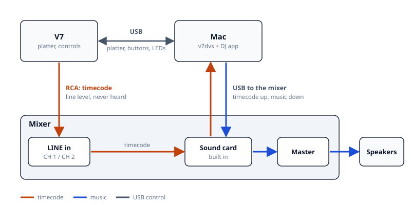
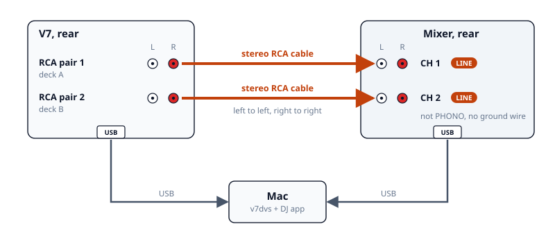
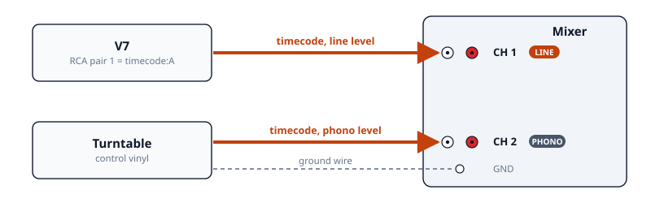

# External timecode on a Mac: the V7 in place of a timecode turntable

For a DJ who already plays DVS: a mixer with a built-in sound card (or a DVS
interface), DJ software that decodes timecode, maybe turntables with control
vinyl. In this mode the V7 takes the place of the turntables. Its RCA outputs
carry **Serato control-vinyl timecode** (2nd Edition, side A) generated from the
real rotation of its platter, and your mixer and software treat it like a
record.

Nothing changes on the software side except two settings: the mixer inputs go
from **PHONO to LINE**, and the vinyl type is **Serato**.

## Quick path

1. Install `v7dvs.app` (see [Install](#install) for the first launch).
2. Cable the V7's two RCA pairs to two mixer channels, inputs on **LINE**.
3. Plug the V7 into the Mac over USB, open v7dvs, set **RCA pair 1** to
   `timecode:A` and **RCA pair 2** to `timecode:B`, press **Save and start**.
4. In the DJ software, use the DVS setup you already have, with the control
   vinyl type set to Serato. Calibrate as you would with a turntable.
5. Press PLAY on the V7. The platter spins, the deck plays.

## What is connected to what

Two cables do two different jobs. USB carries the platter to the Mac and the
controls to the software. The RCAs carry timecode, which is audio you never
listen to.

The timecode leaves the V7 as analog audio, enters the mixer, and reaches the
DJ app through the mixer's sound card: exactly the path a turntable's signal
takes. The music comes back from the app to the mixer the way it always does.

## Install

1. Unzip `v7dvs-<version>-macos.zip` and drag `v7dvs.app` to Applications.
2. First launch: **right-click the app → Open → Open**. macOS says the
   developer is unidentified because this build is not notarized; it asks
   once. On macOS 15 (Sequoia) and later the first launch is refused instead:
   open **System Settings → Privacy & Security**, scroll to the message about
   v7dvs, click **Open Anyway**, then launch again.
3. On an Apple Silicon Mac, macOS offers to install Rosetta the first time.
   Accept: the app is built for Intel and runs under it.

Nothing else to install: no driver, no Python, no audio plug-in.

## Wiring

### One V7, two decks

The V7 has one platter and two decks, A and B, and one RCA pair for each. Both
pairs go to the mixer; the V7's deck selector decides which deck the platter
is driving.

- **LINE, not PHONO.** The V7 puts out line level and no RIAA curve. A phono
  input overloads and bends the signal, and the deck will not track.
- **No ground wire.** There is no cartridge, so nothing to earth.
- **Left to left, right to right.** A crossed pair does not just reverse the
  deck: the software reads it as playing backwards with no position at all.
- If deck A comes up on the wrong mixer channel, swap the two cables, or swap
  `timecode:A` and `timecode:B` in the v7dvs window.

### One V7 next to a turntable

Keep one turntable and replace the other. Only the V7's channel changes to
LINE; the turntable's stays on PHONO with its ground wire.

In v7dvs set pair 1 to `timecode:A` and pair 2 to `none`. If the turntable
plays a different brand of control vinyl, the software has to allow a vinyl
type per deck; if it does not, use Serato vinyl on the turntable too.

## The v7dvs window

| Field | Set it to | Why |
|---|---|---|
| RCA pair 1 | `timecode:A` | deck A's timecode on the first pair |
| RCA pair 2 | `timecode:B` | deck B's timecode on the second pair |
| MIDI port name | `DVS Controller` | a nameless controller; map what you want by hand |
| everything else | leave as it is | calibration values, already measured |

**Save and start** leaves a small window with a **Stop** button. Close it or
press Stop to release the V7. Start v7dvs before the DJ app, so the MIDI port
exists when the app looks for it.

## The DJ software

You have done this for your turntables; the same screens apply.

| Setting | Value |
|---|---|
| Audio device | the mixer, as now |
| Deck inputs | the mixer channels the V7 is cabled to |
| Control vinyl type | **Serato**, 2nd Edition (CV02), side A |
| Vinyl mode | **relative** recommended, see below |
| Calibration | run it with the platter spinning, as with a record |

On the calibration scope a healthy signal is a ring. A ring that looks like
several circles joined on one side is normal: the Serato signal varies in
amplitude by design.

## Playing

| Control on the V7 | What it does here |
|---|---|
| PLAY | starts and stops the **motor**. The deck follows the platter, so do not map it to the software's play. |
| Platter | scratch, nudge, backspin: the timecode follows the real rotation |
| Pitch fader | already inside the timecode. **Do not map it**, or it acts twice. |
| Pitch-zero LED | lights at exactly 0%. The fader has no centre click; trust the light. |
| Deck selector | moves the platter from deck A to deck B |
| Everything else | plain MIDI on the `DVS Controller` port, free to map |

**How one platter plays two decks.** The selected deck follows the platter.
The other deck keeps going on its own: at its last pitch if it was playing,
silent if it was stopped. Start a track on A, switch to B, cue and start B,
and A carries on steady while your hands are on B. Each deck remembers its own
pitch, and the fader picks up from the selected deck's value without a jump.

**The record is about 11 and a half minutes long.** A real control vinyl ends;
this one lifts its own needle and drops it back near the start. In relative
mode the software ignores that and keeps playing. In absolute mode it follows
the needle, and the track jumps. Use relative mode for anything longer than
ten minutes, or use absolute knowing where the edge is.

## If it does not work

| What you see | Likely cause | Try |
|---|---|---|
| No signal on the scope | channel not on LINE, wrong input chosen in the software, or the mixer does not send that channel over USB | check the mixer's input switch and its USB routing |
| Speed follows, position never locks | input too hot: a clipped timecode keeps its pitch and loses its position | lower the channel's input gain; if that does nothing, tell us the mixer model |
| Deck plays backwards, no position | L and R crossed on that RCA pair | swap the two plugs |
| Signal on the scope, deck never tracks | the software expects another vinyl type | set Serato CV02 |
| The other deck moves when you touch the platter | pairs swapped, or the deck selector is on the other deck | swap `timecode:A`/`timecode:B`, check the selector |
| v7dvs does not start, or its Stop window closes by itself | another program may be holding the V7 | quit other DJ software, start v7dvs again, and send the log if it repeats |
| Deck twitches or refuses calibration in one app | that app's decoder may be stricter than others | try the same wiring in [Mixxx](https://mixxx.org) (free): if it locks there, the signal is good |

## What is and is not proven

- Measured through a full analog loop on an Intel MacBook: worst pitch error
  0.0023, position locked with no slips. Mixxx plays it.
- **Apple Silicon is untested.** The app is an Intel build running under
  Rosetta. Your first launch is new information either way.
- **djay has not been confirmed.** On our test Mac it was less tolerant than
  Mixxx on the same signal, before several fixes; it has not been retried
  since. A report from djay, good or bad, is the most useful thing you can
  send.
- One V7 per Mac in this build.

## Reporting

Send `~/Library/Logs/v7dvs.log` (Finder → Go → Go to Folder, paste the path)
with:

- the Mac model and macOS version,
- the mixer model and how the V7 is cabled to it,
- the DJ software and its version, and the vinyl mode (relative or absolute),
- what you did and what you saw. A ten-second phone video of the calibration
  scope is worth a paragraph.

Issues: https://github.com/Hyperwindmill/v7dvs/issues

---

v7dvs is an independent project, not affiliated with or endorsed by Numark,
Serato, Algoriddim (djay), Mixxx, Apple or any other company named in this
guide. Their names are trademarks of their owners, used only to say what the
software works with.
